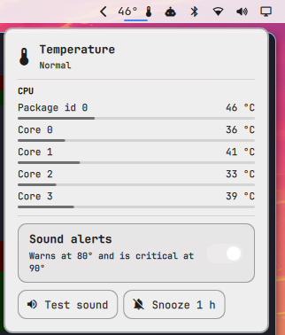

# Temperature for Omarchy

A bar widget for [Omarchy](https://omarchy.org) that shows your CPU
temperature, and plays a sound and sends a notification when the CPU or GPU
gets too hot.



- The bar shows the CPU package temperature. It turns the theme's accent
  colour at the warning threshold and its urgent colour at the critical one.
- Click it for every CPU, GPU and NVMe/disk sensor, each with a meter.
- **Warning** (CPU 80 °C, GPU 85 °C by default): a short sound and a
  notification.
- **Critical** (CPU 90 °C, GPU 95 °C): a different sound and an urgent
  notification. The sound repeats every minute until the temperature drops.
- Readings must stay over a threshold for two polls in a row (about 6 seconds),
  so a quick burst of work doesn't set it off. An alert clears once the
  temperature is 3 °C below the threshold.
- Mute alerts, or snooze them for an hour, from the popup.

Sensors are read straight from `/sys/class/hwmon`: `coretemp` and `k10temp`
(Intel and AMD CPUs), `nouveau`, `amdgpu`, `radeon`, `i915` and `xe` (GPUs),
and `nvme` and `drivetemp` (disks). With the proprietary NVIDIA driver, the
widget uses `nvidia-smi` for the GPU.

## Install

```bash
omarchy plugin add https://github.com/rafabertholdo/omarchy-temperature --enable
```

Pick the bar section when asked; the default is the right side. To update:
`omarchy plugin update io.github.rafabertholdo.temperature`.

To remove it: `omarchy plugin remove io.github.rafabertholdo.temperature`.

## Use

| Action | Does |
| --- | --- |
| Left click | Open the sensor popup |
| Right click | Mute or unmute alerts (remembered across restarts) |
| Middle click | Play the alert sound |

To open the popup from a key, bind
`omarchy-shell shell toggle io.github.rafabertholdo.temperature`.

## Settings

Add any of these to the widget's entry under `bar.layout` in
`~/.config/omarchy/shell.json`. Changes apply when you save.

```json
{
  "id": "io.github.rafabertholdo.temperature",
  "cpuWarn": 85,
  "cpuCritical": 95,
  "criticalSound": "~/Music/alarm.ogg",
  "label": "both"
}
```

| Key | Default | Meaning |
| --- | --- | --- |
| `label` | `"cpu"` | What the bar shows: `cpu`, `gpu`, `both` or `max` |
| `intervalSec` | `3` | Seconds between readings |
| `cpuWarn` / `cpuCritical` | `80` / `90` | CPU thresholds in °C |
| `gpuWarn` / `gpuCritical` | `85` / `95` | GPU thresholds in °C |
| `sound` | `true` | Play alert sounds |
| `notify` | `true` | Send alert notifications |
| `volume` | `1.0` | Alert volume, 0 to 1.5 |
| `repeatSec` | `60` | Repeat the critical sound this often while critical; `0` plays it once |
| `warnSound` | freedesktop `dialog-warning.oga` | Sound file for warnings |
| `criticalSound` | freedesktop `suspend-error.oga` | Sound file for critical alerts |

Sound paths may start with `~/`. Any format `pw-play` reads works: WAV, OGG,
OGA, FLAC.

## Requirements

Omarchy with the Quickshell bar (4.5 or newer), and `pw-play` and
`notify-send`, which Omarchy ships.

## License

MIT
